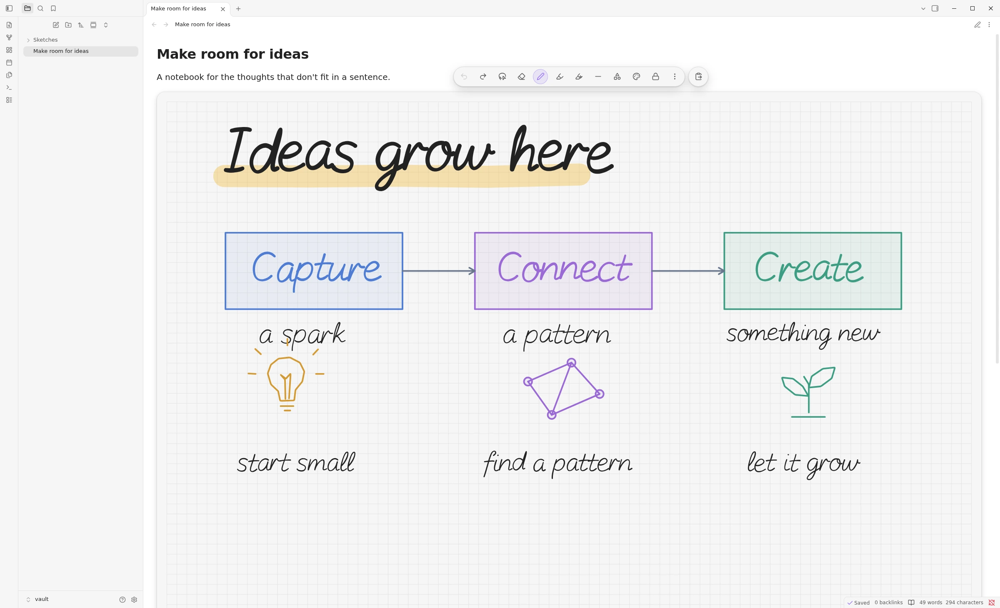
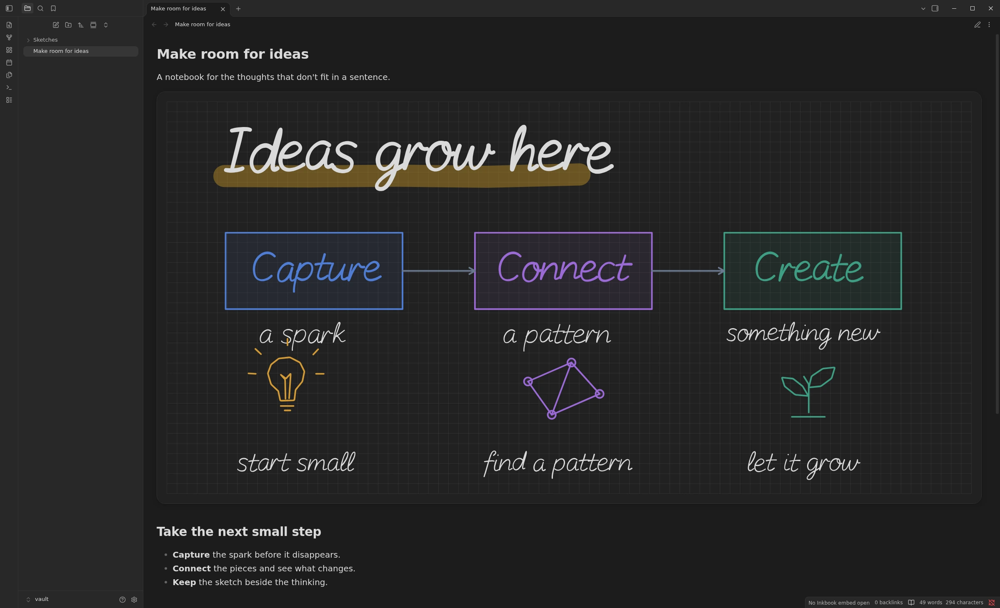

<p align="center">
  
</p>

<p align="center">
  An Obsidian plugin for handwriting, diagrams, and ideas that need more than a keyboard.<br>
  Draw inside your Markdown notes. Keep the result as an editable SVG in your vault.
</p>

<p align="center">
  <strong>Obsidian 1.13.4+</strong> · Desktop and mobile interfaces · Portable SVG · <a href="LICENSE">MIT licensed</a>
</p>

<p align="center">
  <a href="#install">Install from source</a> ·
  <a href="#draw-in-your-note">First sketch</a> ·
  <a href="#development">Development</a> ·
  <a href="https://github.com/boommasterxd/inkbook/issues">Report a bug</a>
</p>



## Make room for your ideas

Work through an equation, connect the steps of a process, or highlight the part you want to remember. Inkbook keeps the drawing beside the text that gives it meaning. Lock it to return to your note; activate the preview to keep drawing.

| You want to…            | Inkbook gives you…                                                                                |
| ----------------------- | ------------------------------------------------------------------------------------------------- |
| **Write and highlight** | A pressure-sensitive pen, freehand and straight highlighters, and a whole-element eraser.         |
| **Sketch and connect**  | Shapes, lines, arrows, coordinate systems, and tables, with connectors that follow shape anchors. |
| **Refine a drawing**    | Selection and lasso, move, resize, rotate, style, and arrange controls.                           |
| **Find your rhythm**    | Zoom, undo and redo, copy and paste, and a page that grows as you write.                          |
| **Choose your paper**   | Plain, lined, dotted, or square backgrounds, with adjustable spacing.                             |

Inkbook embeds work in **Live Preview and Reading view**, including split panes and pop-out windows. One drawing is active per workspace. Touch can navigate the page; drawing with a finger is optional and off by default.

## Your notes stay yours

- **Files in your vault.** Every drawing is a self-contained SVG with an embedded editable snapshot. It remains viewable in an SVG viewer without Inkbook.
- **Local processing.** Inkbook requires no account or remote service and includes no telemetry or analytics. Obsidian and your chosen vault synchronization keep their own settings and behavior.
- **Keep the original.** Save the original Inkbook SVG for future editing. Changes made in an external vector editor are not imported back as Inkbook elements.



Both screenshots show the production plugin running in the real Obsidian desktop application. See the [SVG format and portability contract](docs/svg-envelope.md) for how saved files work outside Obsidian.

## Install

> **Pre-release:** The first GitHub release has not been published. Installation currently requires a source build. Use a test vault while evaluating Inkbook and read the [current limitations](#current-limitations).

You need **Obsidian 1.13.4 or newer**. To build the plugin, also install Git, the latest **Node.js 24.x**, and npm. Node.js is only needed for building, not for running the plugin in Obsidian.

1. Clone the repository and build the production package:

   ```sh
   git clone https://github.com/boommasterxd/inkbook.git
   cd inkbook
   npm ci
   npm run build
   ```

2. Create `<vault>/.obsidian/plugins/inkbook/` and copy all three files from `dist/` into it:

   ```text
   <vault>/.obsidian/plugins/inkbook/
   ├── main.js
   ├── manifest.json
   └── styles.css
   ```

3. Restart Obsidian, allow community plugins if needed, and enable **Inkbook** under **Settings → Community plugins**.

When updating, replace those three files and reload Obsidian. Keep the existing `data.json` to preserve vault settings. Device preferences, such as shortcuts and finger drawing, are stored separately by Obsidian; see [Settings](docs/settings.md).

## Draw in your note

1. Open a Markdown note in editing mode and place the cursor on an empty line.
2. Run **Inkbook: Insert handwriting embed** from the command palette.
3. Write with a pen or mouse, highlight an idea, or choose a shape.
4. Choose **Lock** in the toolbar to save and return to the preview. Activate the preview when you want to edit again.

Inkbook creates the SVG attachment and inserts its reference for you. A reference occupies its own Markdown block:

```markdown
!inkbook[[drawings/my-sketch.svg]]
```

Markdown-style references are supported too. Ordinary `![[drawing.svg]]` and `` embeds remain native Obsidian images. Source mode shows the underlying Markdown. See [Obsidian integration](docs/obsidian-integration.md) for reference syntax and supported surfaces.

## Current limitations

- **Hardware acceptance is ongoing.** Desktop, tablet, and phone layouts have been exercised in Obsidian, but physical mobile devices, pen latency, and palm rejection still require release acceptance. The [verification contract](docs/quality-and-testing.md#manual-release-checks) defines those checks.
- **View-switch issue on Obsidian 1.13.4.** A relative Markdown-style Inkbook embed can become invisible when switching from Reading view to Live Preview. Opening the note in a fresh tab restores the preview. The normal wiki-style reference above worked in the checked flow.

## Development

After the setup above, `npm run dev` watches the source and writes development builds to `dist/`. Copy changed artifacts into your test vault and reload the plugin.

| Command                  | Purpose                                                            |
| ------------------------ | ------------------------------------------------------------------ |
| `npm run build`          | Produce the production plugin package.                             |
| `npm run package:verify` | Check the generated artifacts and version consistency.             |
| `npm test`               | Run Unit and focused Integration tests.                            |
| `npm run test:coverage`  | Run those tests with enforced coverage.                            |
| `npm run benchmark`      | Run deterministic work, resource, and scheduling contracts.        |
| `npm run docs:check`     | Check documentation links, fences, and the complete index.         |
| `npm run ci`             | Run the complete local quality and performance gate when required. |

Run checks relevant to your change; the full gate remains available when comprehensive verification is needed. Performance checks observe work and resources, while physical-device responsiveness is assessed separately.

The code separates pure domain logic, editor interactions, imperative SVG rendering and React chrome, persistence and workers, and Obsidian integration. Start with the [architecture flows](docs/architecture-flows.md) and follow the [contribution guide](CONTRIBUTING.md).

## Documentation and feedback

| Guide                                                | What you will find                                            |
| ---------------------------------------------------- | ------------------------------------------------------------- |
| [Editor tools](docs/editor-tools.md)                 | Drawing, selection, shapes, connections, erasing, and styles. |
| [Features](docs/features.md)                         | Paper, page growth, history, clipboard, and locking.          |
| [Keyboard shortcuts](docs/keyboard-shortcuts.md)     | Canvas bindings and customization.                            |
| [Settings](docs/settings.md)                         | Tool defaults and vault or device preferences.                |
| [Obsidian integration](docs/obsidian-integration.md) | Embed syntax, host behavior, and release requirements.        |

The [complete documentation index](AGENTS.md#documentation-index) links all maintained technical guides.

For bugs and feature requests, use [GitHub Issues](https://github.com/boommasterxd/inkbook/issues). Include your Obsidian version, operating system, input device, and reproduction steps. Share a minimal example without private vault content. Report security vulnerabilities privately using [SECURITY.md](SECURITY.md).

## License

Inkbook is [MIT licensed](LICENSE), copyright (c) 2026 Yannick Schäfer. Bundled third-party components and the adapted Lucide highlighter icon retain their own licenses; required notices are included in `LICENSE` and the generated plugin bundle.
