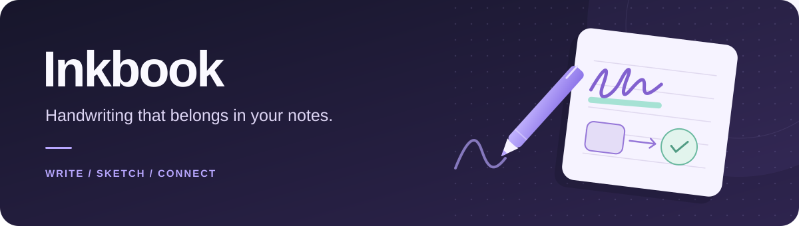
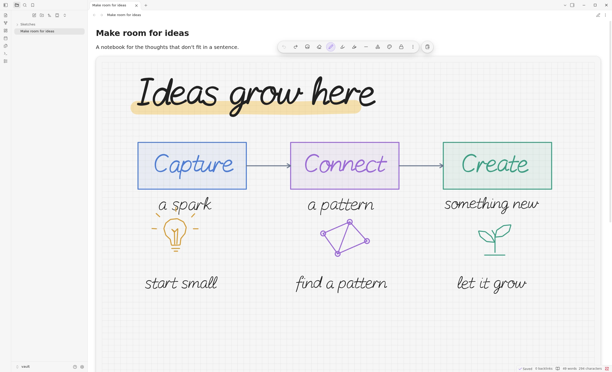
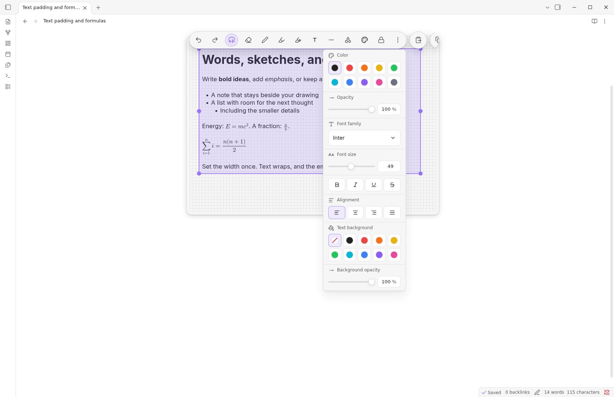
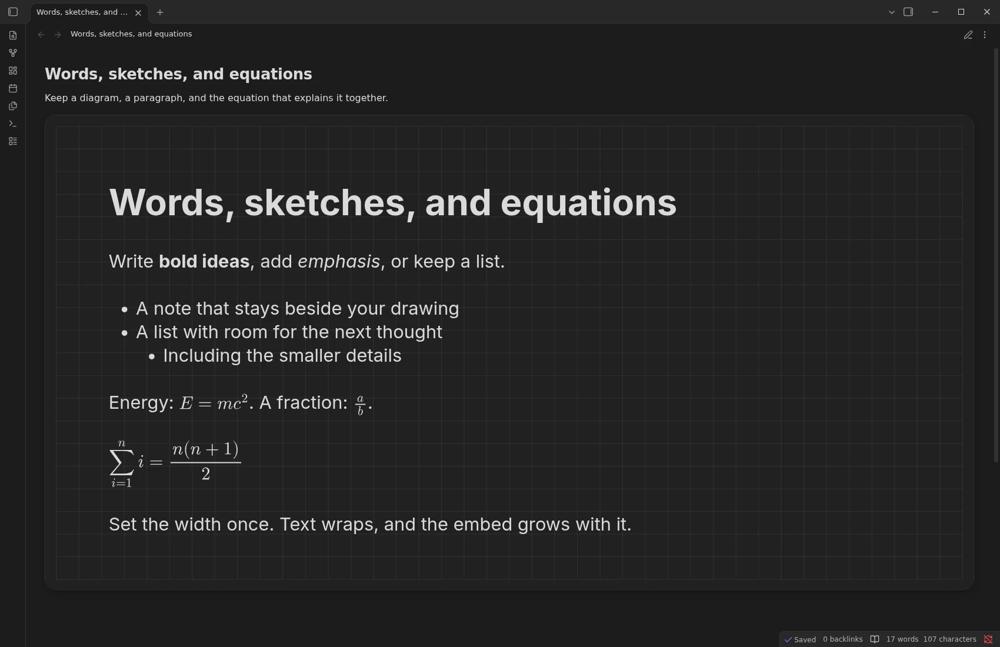
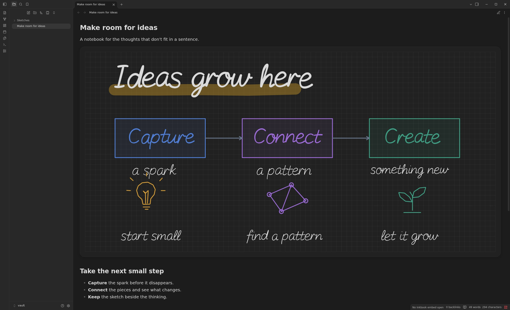

<p align="center">
  
</p>

<p align="center">
  An Obsidian plugin for handwriting, diagrams, and ideas that need more than a keyboard.<br>
  Draw inside your Markdown notes. Keep the result as an editable SVG in your vault.
</p>

<p align="center">
  <strong>Obsidian 1.13.4+</strong> · Desktop and mobile interfaces · Portable SVG · <a href="LICENSE">MIT licensed</a>
</p>

<p align="center">
  <a href="#install">Install from source</a> ·
  <a href="#draw-in-your-note">First sketch</a> ·
  <a href="#development">Development</a> ·
  <a href="https://github.com/boommasterxd/inkbook/issues">Report a bug</a>
</p>



## Make room for your ideas

Work through an equation, connect the steps of a process, or highlight the part you want to remember. Inkbook keeps the drawing beside the text that gives it meaning. Lock it to return to your note; activate the preview to keep drawing.

| You want to…            | Inkbook gives you…                                                                                                                      |
| ----------------------- | --------------------------------------------------------------------------------------------------------------------------------------- |
| **Write and highlight** | A pressure-sensitive pen, freehand and straight highlighters, and a whole-element eraser.                                               |
| **Sketch and connect**  | Shapes including stars, straight or curved lines and arrows, coordinate systems, and tables, with connectors that follow shape anchors. |
| **Hold to shape**       | Hold a pen stroke still to preview a native shape; release to accept or continue drawing to cancel.                                     |
| **Type and format**     | Multiline text fields with Markdown tables, LaTeX formulas, local fonts, text colors, and backgrounds.                                  |
| **Annotate a source**   | Import PNG, JPEG, static WebP or selected PDF pages below your annotations; crop images without losing imported pixels.                 |
| **Bring existing ink**  | Convert supported Obsidian Ink drawings already embedded in notes and review the changes before applying them.                          |
| **Refine a drawing**    | Selection and lasso, move, resize, rotate, style, and arrange controls.                                                                 |
| **Find your rhythm**    | Zoom, undo and redo, copy and paste, and a page that grows as you write.                                                                |
| **Choose your paper**   | Plain, lined, dotted, or square backgrounds, with adjustable spacing.                                                                   |

Inkbook embeds work in **Live Preview and Reading view**, including split panes and pop-out windows. One drawing is active per workspace. Touch can navigate the page; drawing with a finger is optional and off by default.

Inkbook's interface supports English and German. It follows Obsidian's language by default. To change it, open **Settings → Inkbook → Appearance → Language**.

## Add words and formulas

Choose **Text** and drag out a field, or paste text onto the active canvas with **Ctrl+V** (**Cmd+V** on macOS). Markdown and LaTeX render inside the field. Select a field, then click or tap it again to edit, including with a pen. While editing, click formatted text or a formula to reveal its source in place.

Text wraps at the width you choose. Side handles change that width; corner handles scale the text. The embed grows downward as the field needs more room. Select words to format them, or style an entire field with alignment, color, and a background.



The font dropdown previews each family in its own typeface. Inter, Source Serif 4, Caveat, and JetBrains Mono are included; add your own font files in Inkbook's settings. Saved SVGs embed only the font faces they use. Text and formulas also participate in Obsidian's native PDF export.



See [Text fields](docs/text-fields.md) for supported formatting, fonts, and export behavior. Use the Image action to import PNG, JPEG, static WebP or selected PDF pages, then draw or highlight above them. Images remain inside the self-contained SVG; cropping retains the complete imported pixels. Inkbook uses lossless WebP when it is smaller than the previous format, with PNG/JPEG fallback. See [Images and PDF pages](docs/images.md) for import, crop, reader compatibility and capacity limits.

## Install

> **Pre-release:** The first GitHub release has not been published. Installation currently requires a source build. Use a test vault while evaluating Inkbook and read the [current limitations](#current-limitations).

You need **Obsidian 1.13.4 or newer**. To build the plugin, also install Git, the latest **Node.js 26.x**, and npm. Node.js is only needed for building, not for running the plugin in Obsidian.

1. Clone the repository and build the production package:

   ```sh
   git clone https://github.com/boommasterxd/inkbook.git
   cd inkbook
   npm ci
   npm run build
   ```

2. Create `<vault>/.obsidian/plugins/inkbook/` and copy all three files from `dist/` into it:

   ```text
   <vault>/.obsidian/plugins/inkbook/
   ├── main.js
   ├── manifest.json
   └── styles.css
   ```

3. Restart Obsidian, allow community plugins if needed, and enable **Inkbook** under **Settings → Community plugins**.

When updating, replace those three files and reload Obsidian. Keep the existing `data.json` to preserve vault settings. Device preferences, such as shortcuts and finger drawing, are stored separately by Obsidian; see [Settings](docs/settings.md).

## Draw in your note

1. Open a Markdown note in editing mode and place the cursor on an empty line.
2. Run **Inkbook: Insert handwriting embed** from the command palette.
3. Write with a pen or mouse, highlight an idea, choose a shape, or add a [text field](docs/text-fields.md) with Markdown, formulas, and local fonts.
4. Choose **Lock** in the toolbar to save and return to the preview. Activate the preview when you want to edit again.

The first empty embed you open offers an optional toolbar tour, including the Text tool and its Markdown and formula editing. Choose **Start tour** or **Skip tour**, and skip the remaining steps whenever you like. The invitation will not appear again on this device and vault. You can reopen the tour through **More options → Quick tour** while the active embed is empty. Existing or imported drawings do not offer the tour.

For wider drawings, turn off Obsidian's **Editor → Readable line length** setting. Inkbook's settings offer the same change when the column is limited.

Inkbook creates the SVG attachment and inserts its reference for you. A reference occupies its own Markdown block:

```markdown
![[drawings/my-sketch.svg]]
```

Markdown-style references such as `` are supported too. Add a native width such as `![[drawing.svg|400]]` or `` to constrain both the preview and editor; narrower screens cap the width automatically. The saved reference displays a native SVG image even with Inkbook disabled or uninstalled. Inkbook enhances eligible standalone references only after recognizing a safe Inkbook document; ordinary images remain native. Source mode shows the underlying Markdown. Recognized references use current-document PDF preparation and Inkbook pagination.

Inkbook uses native image references exclusively. The plugin does not convert notes on activation. See [Obsidian integration](docs/obsidian-integration.md#native-embeds) for recognition, supported sizes, and host-owned fallback behavior.

To convert supported Obsidian Ink drawings, open **Settings → Inkbook → Import → Start import**. The [import guide](docs/features.md#importing-from-obsidian-ink) covers selection, review, and recovery.

## Your notes stay yours

- **Files in your vault.** Every drawing is a self-contained SVG with an embedded editable snapshot. It remains viewable in an SVG viewer without Inkbook.
- **Local processing.** Inkbook requires no account, subscription, or remote service and includes no telemetry or analytics. Obsidian and your chosen vault synchronization keep their own settings and behavior.
- **Local version checks.** Inkbook keeps a small [version index](docs/obsidian-integration.md#settings-boundary) on each device for each vault. It helps detect an older drawing or different contents at the same revision.
- **Storage for import recovery.** Obsidian Ink conversion preserves originals and creates recovery backups in your vault. These files use extra vault storage and can be included in vault sync.
- **Keep the original.** Save the original Inkbook SVG for future editing. Changes made in an external vector editor are not imported back as Inkbook elements.



See the [SVG format and portability contract](docs/svg-envelope.md) for how saved files work outside Obsidian.

## Current limitations

- **Hardware acceptance is pending.** Physical mobile device behavior, pen latency, and palm rejection still require the [manual release checks](docs/manual-release-checks.md).
- **Minimum-version acceptance is pending for native embeds.** Switching between Reading view and Live Preview with native image references still requires release verification on the [declared minimum version](docs/obsidian-integration.md#authority-and-support-surface).

## Development

After the setup above, `npm run dev` watches the source and writes development builds to `dist/`. Copy changed artifacts into your test vault and reload the plugin.

| Command                  | Purpose                                                            |
| ------------------------ | ------------------------------------------------------------------ |
| `npm run build`          | Produce the production plugin package.                             |
| `npm run package:verify` | Check the generated artifacts and version consistency.             |
| `npm test`               | Run and validate the complete Unit and Integration suite.          |
| `npm run benchmark`      | Run the viewport and pen-input performance contracts.              |
| `npm run docs:check`     | Check documentation links, fences, and the complete index.         |
| `npm run ci`             | Run the complete local quality and performance gate when required. |

Run checks relevant to your change and complete the required verification before handoff. Profile affected performance in running Obsidian and compare the same interaction after changes. See [Performance Verification](docs/performance-ci.md).

The code separates pure domain logic, editor interactions, imperative SVG rendering and React chrome, persistence and workers, and Obsidian integration. Start with the [architecture flows](docs/architecture-flows.md) and follow the [contribution guide](CONTRIBUTING.md).

## Documentation and feedback

| Guide                                                | What you will find                                                       |
| ---------------------------------------------------- | ------------------------------------------------------------------------ |
| [Editor tools](docs/editor-tools.md)                 | Drawing, selection, shapes, connections, erasing, and styles.            |
| [Text fields](docs/text-fields.md)                   | Markdown, LaTeX, fonts, text formatting, and portable output.            |
| [Images and PDF pages](docs/images.md)               | Local import, nondestructive crop, resource limits, and portable images. |
| [Features](docs/features.md)                         | Paper, page growth, history, clipboard, and locking.                     |
| [Keyboard shortcuts](docs/keyboard-shortcuts.md)     | Canvas bindings and customization.                                       |
| [Settings](docs/settings.md)                         | Tool defaults and vault or device preferences.                           |
| [Obsidian integration](docs/obsidian-integration.md) | Embed syntax, host behavior, and release requirements.                   |

The [complete documentation index](AGENTS.md#documentation-index) links all maintained technical guides.

For bugs and feature requests, use [GitHub Issues](https://github.com/boommasterxd/inkbook/issues). Include your Obsidian version, operating system, input device, and reproduction steps. Share a minimal example without private vault content. Report security vulnerabilities privately using [SECURITY.md](SECURITY.md).

## License

Inkbook is [MIT licensed](LICENSE), copyright (c) 2026 Yannick Schäfer. Bundled third-party components and the adapted Lucide highlighter icon retain their own licenses; required notices are included in `LICENSE` and the generated plugin bundle.
