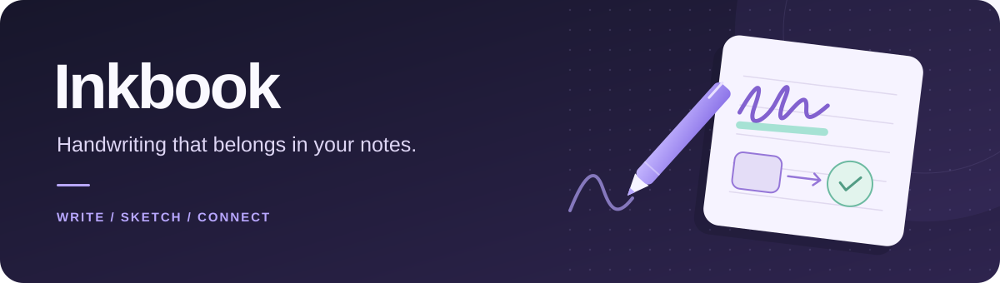

<p align="center">
  
</p>

<p align="center">
  Draw, highlight, and connect ideas directly in your Obsidian notes.<br>
  Keep every drawing as a portable, editable SVG in your vault.
</p>

<p align="center">
  <a href="#get-started"></a>
  <a href="#make-room-for-your-ideas"></a>
  <a href="#your-files-in-your-vault"></a>
  <a href="LICENSE"></a>
</p>

<p align="center">
  <a href="#get-started">Get started</a> ·
  <a href="#build-from-source">Build from source</a> ·
  <a href="#documentation">Documentation</a> ·
  <a href="https://github.com/boommasterxd/inkbook/issues">Report a bug</a>
</p>

> **Release candidate:** The first-release implementation is present and undergoing validation. Real-device acceptance, including mobile hardware and pen input, remains a release step.

## Make room for your ideas

Jot down an equation, highlight a passage, or sketch a diagram with **pen, touch, or mouse**. Lock the drawing when you are done and keep reading. Every drawing stays viewable outside Obsidian, without the plugin.

|                       | What you can do                                                                                         |
| --------------------- | ------------------------------------------------------------------------------------------------------- |
| **Write & highlight** | Use a pressure-sensitive pen, freehand highlighter, straight highlighter, and whole-element eraser.     |
| **Sketch & connect**  | Draw lines, arrows, geometric shapes, coordinate systems, and tables. Snap connectors to shape anchors. |
| **Select & refine**   | Select or lasso elements, move, resize, rotate, change styles, and adjust their order.                  |
| **Choose your paper** | Switch between plain, lined, dotted, and square backgrounds. The page expands as you write.             |
| **Keep your flow**    | Zoom, undo, redo, and copy or paste elements while staying in your note.                                |
| **Read & return**     | Use locked previews in Live Preview and Reading view, then activate a drawing to edit it again.         |

Inkbook supports tabs, split panes, and pop-out windows, with one active drawing editor per workspace. Touch can navigate the page; finger drawing is optional and disabled by default.

## Get started

Requires **Obsidian 1.13.4 or newer** and an installed Inkbook build. See [Build from source](#build-from-source) for installation.

1. Open a Markdown note in editing mode and place the cursor on an empty line.
2. Run **Inkbook: Insert handwriting embed** from Obsidian's command palette.
3. Draw with a pen or mouse, choose a tool, or add a shape.
4. Choose **Lock** in the toolbar to save and return to the preview.

Inkbook creates the SVG attachment and inserts its reference for you. A reference looks like this, on its own line:

```markdown
!inkbook[[drawings/my-sketch.svg]]
```

Markdown-style links are supported too:

```markdown
!inkbook[My sketch](drawings/my-sketch.svg)
```

These references must point to an Inkbook-created SVG. Ordinary `![[drawing.svg]]` and `` embeds keep Obsidian's native image behavior. Source mode always shows the Markdown text.

## Your files, in your vault

- **Portable output.** Each saved SVG includes the drawing, background, light and dark palettes, and editable snapshot.
- **Local processing.** No account, telemetry, analytics, or remote service is required by the plugin. Vault synchronization remains controlled by your Obsidian setup.
- **Editable source of truth.** Keep the original Inkbook SVG when using external tools; the embedded snapshot is required for further editing in Inkbook. External SVG edits are not imported as Inkbook elements.

See the [file format](docs/file-format.md) and [SVG portability contract](docs/svg-envelope.md) for details.

## Build from source

Use the latest **Node.js 24.x** release and npm. If you use nvm, `nvm install` reads the major alias from `.nvmrc`.

```sh
git clone https://github.com/boommasterxd/inkbook.git
cd inkbook
npm ci
npm run build
```

The production package is generated in `dist/`. Copy these three files into your vault's plugin directory:

```text
<vault>/.obsidian/plugins/inkbook/
├── main.js
├── manifest.json
└── styles.css
```

Restart Obsidian, allow community plugins if needed, and enable **Inkbook** under **Settings → Community plugins**. Use a test vault while evaluating the release candidate.

For development, `npm run dev` watches the source and writes development builds to `dist/`. Copy updated artifacts to the test vault and reload the plugin to apply changes.

## Development

| Command                  | Purpose                                                     |
| ------------------------ | ----------------------------------------------------------- |
| `npm run dev`            | Watch source and emit a development build.                  |
| `npm run build`          | Generate the production plugin package.                     |
| `npm test`               | Run Unit and focused Integration tests.                     |
| `npm run test:coverage`  | Run those tests with enforced coverage thresholds.          |
| `npm run benchmark`      | Run deterministic work, resource, and scheduling contracts. |
| `npm run ci`             | Run the complete local quality and performance gate.        |
| `npm run package:verify` | Verify generated release artifacts and version consistency. |

The code is organized into five areas: pure `domain` logic, `editor` interactions, imperative SVG `rendering` with React application chrome, `persistence` and document workers, and `obsidian` host integration. See the [architecture flows](docs/architecture-flows.md) for ownership and data flow.

Performance verification uses deterministic work and resource bounds, including large-document fixtures. Physical-device responsiveness remains a separate acceptance check; see [quality and testing](docs/quality-and-testing.md).

### GitHub automation

Pull requests targeting `main` run checks selected from the complete change set. The required checks are `CI`, `Performance (shared)`, `Performance (refresh profiles)`, `gitleaks`, and `Validate PR Title`. GitHub requires current branches and squash merges. See [CI selection](docs/ci-selection.md) for documentation-only checks, conservative fallbacks, and coverage scope.

## Documentation

| Start here                                            | Read about                                                |
| ----------------------------------------------------- | --------------------------------------------------------- |
| [Editor tools](docs/editor-tools.md)                  | Drawing, shapes, selection, erasing, and connectors       |
| [Features](docs/features.md)                          | Backgrounds, history, clipboard, and input behavior       |
| [Keyboard shortcuts](docs/keyboard-shortcuts.md)      | Canvas bindings, modifiers, and shortcut configuration    |
| [Settings](docs/settings.md)                          | Tool defaults, page preferences, and device settings      |
| [Obsidian integration](docs/obsidian-integration.md)  | Embed syntax, host lifecycle, compatibility, and releases |
| [Implementation specification](docs/specification.md) | Scope, architecture, and core contracts                   |

The complete documentation index is maintained in [AGENTS.md](AGENTS.md#documentation-index).

## Feedback and contributions

For bugs and feature requests, use the repository's [issue tracker](https://github.com/boommasterxd/inkbook/issues). Include your Obsidian version, operating system, input device, and steps to reproduce the problem. Use a minimal example without private vault content.

Read [CONTRIBUTING.md](CONTRIBUTING.md) before preparing changes. Report security vulnerabilities privately as described in [SECURITY.md](SECURITY.md).

Pull request creation is currently limited to repository collaborators. Bug reports and feature requests remain welcome through Issues.

## License

Inkbook is licensed under the [MIT License](LICENSE). Copyright (c) 2026 Yannick Schäfer. Bundled third-party components retain their own licenses; their required notices are included in `LICENSE` and the generated plugin bundle.
