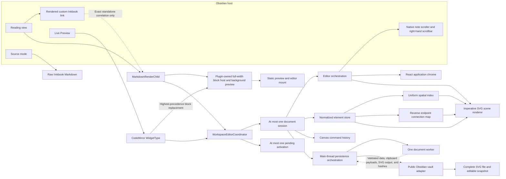
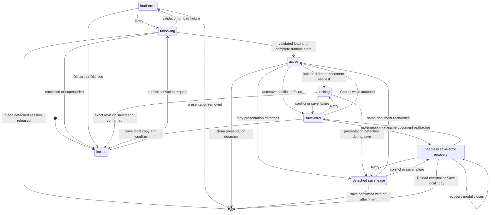
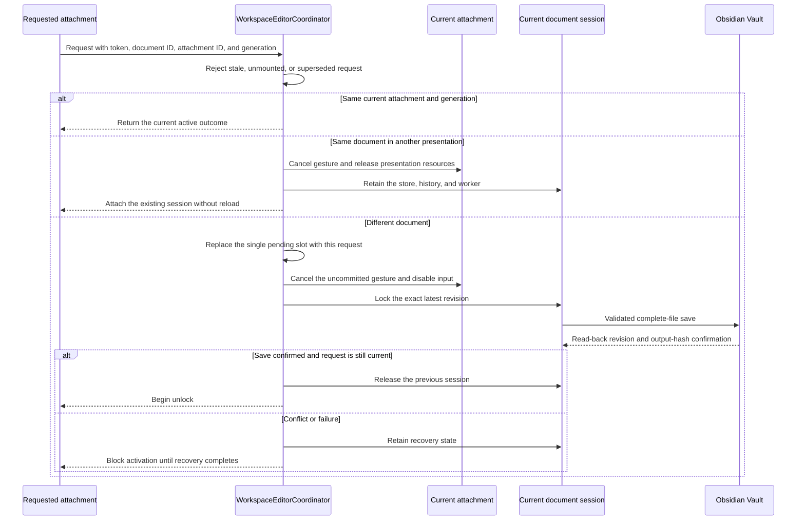
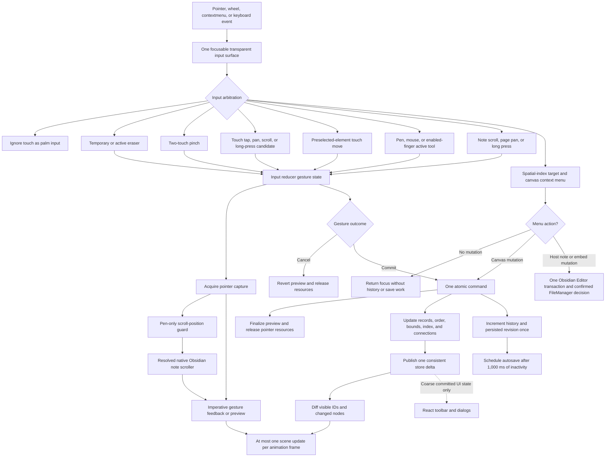
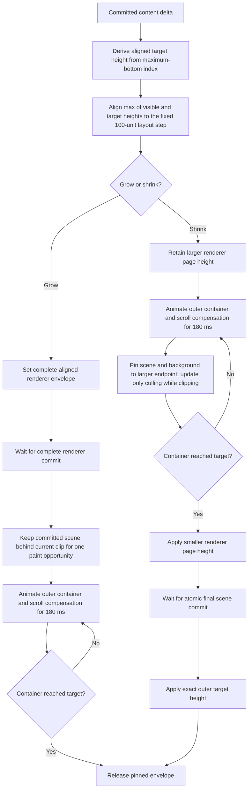
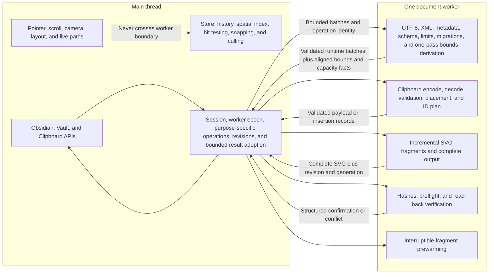
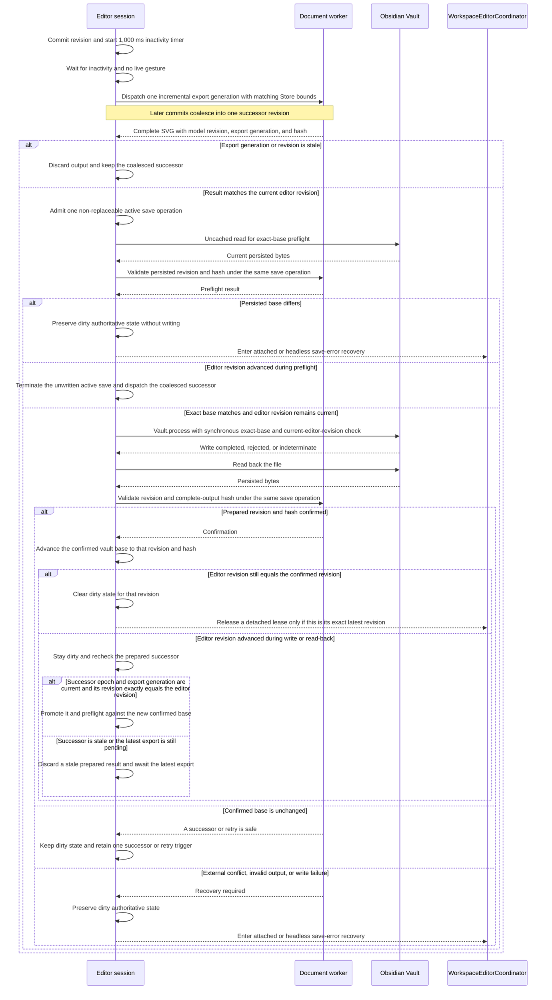

# Architecture and Runtime Flows

This document is an informative visual map of Inkbook's runtime architecture. The linked specifications remain normative when a diagram omits a detail or appears ambiguous.

## System Ownership

The presentation owner releases its own DOM, React root, adaptive menu sessions, listeners, observers, timers, pointer capture, and animation frames. The coordinator owns only the authoritative session, worker, activation records, and any bounded detached-save or recovery lease. The editable session also owns the interactive-work gate described in [Rendering and Performance](rendering-and-performance.md); persistence receives its wait callback rather than importing editor state. React renders controls and coarse state, never ink elements or the pointer-to-frame render path.

## Document Session Lifecycle

This diagram describes the authoritative document-session state. Its `load-error` state is reached only when unlocking cannot produce a validated runtime document: Retry returns that session to `unlocking`, while Discard or Dismiss returns it to `locked`. By contrast, the per-embed state table in the [Implementation specification](specification.md#document-and-editor-states) also allows a presentation-local `active` to `load-error` transition when editor-chrome mounting fails. That presentation disposes its scene, returns to the static preview, and exposes retry UI without changing the authoritative document session from `active`; normal lock, detach, and recovery coordination still govern that session.

Only one workspace session may be in `unlocking`, `active`, `locking`, `save-error`, detached-save, or headless-recovery mode. Detached saving and headless recovery are coordinator ownership modes for the same document session, not additional persisted editor states.

## Activation Across Tabs, Panes, and Pop-out Windows

An attachment is identified by its opaque ID and generation, so the same file mounted in another tab or window does not create a second store. A widget unload cancels its matching pending request. Separate Obsidian processes have separate coordinators and rely on file conflict detection rather than an in-memory workspace lock.

## Pointer Input, Preview, Commit, and Rendering

Pointer movement applies direct imperative feedback and creates no element records, history entries, React renders, or save work. Committed SVG paths and decorative overlays receive no pointer events and own no listeners. Creation and transformation gestures mutate preview nodes, and selection overlays apply the same algebraic transform in the same frame. An unselected touch target remains in `touch-pending` until release confirms a short tap or movement permanently resolves to pan or scroll; navigation never emits selection changes. Only a target selected before contact may enter `element-move`. Eligible mouse and pen input outside the current selection may emit one session-only clear before its content preview; claimed finger drawing defers that clear until commit so a preview cancelled into pinch remains selection-neutral. `page-pan` updates the horizontal camera and may continue through the shared kinetic animation frame without writing native `scrollTop`, while `note-scroll` classifies lifecycle only and leaves vertical motion plus kinetic scrolling to the native Obsidian scroll owner. Pending and vertically classified touch events remain available to the host; propagation is contained only after Inkbook claims horizontal page pan, pinch, finger drawing, or a preselected-element move. The reducer states are `idle`, `touch-pending`, `note-scroll`, `page-pan`, `element-move`, `lasso`, `eraser-gesture`, `tool-gesture`, and `pinch`. Rectangle and freeform-lasso selection query candidates through the spatial index by area bounds before applying the configured geometry-aware inclusion predicate. Candidate lookup for hit testing, context targets, erasing, culling, and snapping likewise uses the spatial index. A target transform follows the reverse connection map so connected arrow and line endpoints update without scanning all elements.

The native-scrollbar lease is acquired before Inkbook's first width-derived preview or editor measurement and remains unchanged across lock and unlock for the complete recognized-presentation lifetime. It is not a pointer-state transition. Inkbook measures its own background container and clamps its right edge to the resolved scroller's client edge; the canvas never adopts the pane width or covers the right-hand gutter. A live layout move acquires the new lease and adopts post-style geometry before releasing the old lease in the next frame, while a destroyed presentation releases immediately. The pen scroll guard only restores an unexpected `scrollTop` change in the next animation frame.

The command history in this flow belongs to the Inkbook canvas. Creating an embed, replacing its Markdown target, or applying other host-note text changes uses one Obsidian `Editor` transaction and the pane's own undo history instead.

## Imperative Rendering and Frame Scheduling

```mermaid
flowchart TD
  storeDelta["Domain-classified store delta with versions"] --> dirty["Set geometry, paint, order, connection, or visibility flags"]
  dirty --> scheduler{"Scene frame already pending?"}
  gestureUpdate["Gesture, camera, scroll, or zoom update"] --> scheduler
  hostUpdate["Resize or host-layout invalidation"] --> scheduler

  scheduler -->|No| queue["Queue one animation frame"]
  scheduler -->|Yes| coalesce["Coalesce reasons into the pending frame"]
  queue --> frame["Begin scene frame"]
  coalesce --> frame

  frame --> generation{"Generation is current?"}
  generation -->|No| discard["Discard stale work"]
  generation -->|Yes| priority["Prioritize live input, camera and overlays, mounted changes, visibility, then background"]
  priority --> reads["Read phase: cached geometry, viewport, and layout"]
  reads --> domainGates["Evaluate dirty-domain gates without DOM writes"]
  domainGates --> sceneValues["Prepare dirty camera and overlay values"]
  domainGates --> contentGate{"Content or visibility dirty?"}
  domainGates --> backgroundGate{"Background dirty?"}
  contentGate -->|No| reuseContent["No content calculation or write"]
  contentGate -->|Yes| visibilityGate{"Visibility or viewport dirty?"}
  visibilityGate -->|No| mountedChanges["Use dirty mounted IDs only"]
  visibilityGate -->|Yes| hysteresis{"Viewport plus 40-pixel reserve remains inside the retained envelope?"}
  hysteresis -->|Yes| reuseVisibility["Reuse published visibility and sorted bands"]
  hysteresis -->|No| visibleRect["Calculate viewport plus 80 screen pixels of overscan"]
  reuseVisibility --> reuseContent
  visibleRect --> spatialQuery["Query spatial grid and bounded overflow collection"]
  spatialQuery --> candidateCache{"Same cell range and no relevant cell delta?"}
  candidateCache -->|Yes| reuseCandidates["Reuse numeric candidate slots"]
  candidateCache -->|No| refillCandidates["Refill reusable slots and epoch markers"]
  reuseCandidates --> exactBounds["Reject nonintersecting conservative bounds"]
  refillCandidates --> exactBounds
  exactBounds --> visibleSet["Fill reusable next-visible slots"]
  visibleSet --> membership{"Band membership changed?"}
  membership -->|No| reuseVisibility
  membership -->|Yes| sorted["Sort visible bands by rank and ID"]

  sorted --> diff["Diff against the ID-to-node map"]
  storeDelta --> changedIds["Changed IDs and affected rank data"]
  changedIds --> mountedChanges
  mountedChanges --> work
  diff --> work["Entrants, exits, changed nodes, and affected reorders only"]
  work --> mountBudget{"Shared deadline and live-root publication allowance permit the next entrant?"}
  mountBudget -->|No| nextFrame
  mountBudget -->|Yes| pathCache{"Versioned path or immutable local stroke shape cached?"}
  pathCache -->|Yes| reuse["Reuse the path"]
  pathCache -->|No| build["Build only the required mounted path"]
  reuse --> applied["Compare applied node versions and attributes"]
  build --> applied
  applied --> preparedContent["Prepare changed content attributes or child order"]

  backgroundGate -->|No| reuseBackground["No background calculation or write"]
  backgroundGate -->|Yes| backgroundCache{"Full-page background cache key changed?"}
  backgroundCache -->|No| reuseBackground
  backgroundCache -->|Yes| rebuildBackground["Prepare one bounded pattern coverage path"]

  sceneValues --> prepared["Join prepared domain results"]
  reuseContent --> prepared
  preparedContent --> prepared
  reuseBackground --> prepared
  rebuildBackground --> prepared
  prepared --> writes["Write phase: apply only prepared changed DOM state"]
  writes --> bands["Preserve fixed highlight and content render bands"]
  bands --> release["Release replaced entries and enforce DOM and cache caps"]
  release --> remaining{"Input-aware reconciliation work remains?"}
  remaining -->|Yes| nextFrame["Keep the last complete frame and queue one successor"]
  nextFrame --> frame
  remaining -->|No| complete["Frame complete without a React render"]
```

The workspace injects one `WorkScheduler` per owning window into scene, editor, preview, host presentation, and persistence paths. Its platform-independent policy lives in `domain/scheduling`; native scheduling belongs to the window adapter and the document worker adapter. Workers receive live profile updates and use their own thread slice budget with central task admission, without waiting for a synthetic display frame. Main-thread fallback uses the owning window's frame policy. See [Central Work Scheduling](rendering-and-performance.md#central-work-scheduling).

The ordinary frame cost follows reusable spatial-index candidates, mounted visible elements, and the classified published delta, rather than all 10,000 stored strokes. A refresh mounts the viewport plus 80 screen pixels of overscan. That envelope is retained while the current viewport plus a 40-screen-pixel safety reserve remains inside it, so small camera movements perform neither classification nor sorting and never omit visible content. A later refresh reuses the sorted bands when membership and order remain unchanged. The renderer mutates only entering, exiting, changed, or affected reordered nodes and attributes. Large or unusually dense viewports reconcile every exact visible element through a persistent band-and-rank cursor. Each centrally admitted slice uses the owning window's shared absolute deadline between bounded work units, retains the separate live-root publication allowance, and reuses the unchanged viewport query while the last complete frame remains visible.

All layout reads happen before pure calculations and DOM writes, so the frame does not alternate between layout measurement and mutation. World-space prepared paths and anchor entries require the same element ID and geometry version. Local stroke paths instead reuse immutable samples and matching shape attributes across position changes, under the [path-cache contract](rendering-and-performance.md#path-caches). The recently unmounted main-thread path LRU is capped at 4,096 entries and 32 MiB, and the target-anchor LRU at 4,096 targets and 8 MiB, with the active-document memory ceiling taking precedence. Background guides use one bounded full-page SVG pattern coverage path plus an optional terminal-edge path, both derived from the same fixed frame and canonical axes as standalone export. They regenerate only when page or pattern geometry changes, never for viewport clipping or camera pan. Transform previews use SVG transforms, and visible connected endpoints follow their target during the same frame. Bounds, spatial-index cells, and affected endpoint records update once on commit. A pure stroke translation retains its local path and updates its placement.

React receives at most one coarse notification after a consistent committed transaction or discrete UI transition. Pointer samples, preview geometry, camera changes, culling, snapping, connection propagation, and animation-frame work stay entirely in the imperative renderer. This prevents the 10,000-stroke scene from producing component renders or virtual-tree work on the hot path.

## Page-Height Scene Handoff

Unlock uses one persistent presentation-root shell with a 240-millisecond block-size transition. That shell continuously owns the page surface, border, radius, and clipping edge. The active scene prepares and paints all actually visible elements, including the pending transition viewport, behind the locked inner preview. Animated handoff requires an unchanged scene commit proof across the intervening paint before the two borderless representations exchange visibility atomically in the frame that starts container growth. Reduced motion permits immediate exchange with a current complete proof. Input then enables and deferred overscan begins under the same scheduler. The hidden preview remains lifecycle-owned until transition cleanup. Lock prepares and paints the exact persisted preview below the disabled editor, then performs the same zero-duration inner-layer exchange before removing the editor. Neither direction animates shell opacity or replaces the shell. The complete initial-readiness contract is defined in [Viewport Culling](rendering-and-performance.md#viewport-culling).

Unlock, automatic growth, and shrink prepare one scene envelope that is never shorter than the currently visible canvas. Active targets align to 100-unit writing rows; non-empty patterned locked targets align to the committed pattern row. The pattern spans the complete envelope before growth begins. Intermediate viewport reads may update visible element membership, but they cannot regenerate or realign the background. Automatic shrink retains the larger geometry for the complete clip transition. The smaller background and exact outer target height become paintable together only after the final scene commit. Background type and spacing previews do not enter the active-height flow; their committed value determines the next locked target.

## Document Worker Boundary and Queue

The worker runs one non-preemptive job. Unlock and migration are exclusive before activation. Active-session priority is lifecycle and recovery verification, one explicit clipboard operation, one coalesced due export, then interruptible prewarming. Worker failure invalidates its epoch and switches once to the same pure algorithms in bounded, input-aware main-thread slices. Export generations order replaceable export results. Only admission of a current result creates the non-replaceable active save operation that spans preflight through write classification; clipboard plus unlock use independent operation IDs. There is no worker pool and no worker owns DOM, React, input, camera, scroll, the spatial index, or an Obsidian API.

## Incremental Export, Complete Save, and Recovery

Incremental export updates worker-owned fragments, but every successful persistence pass writes one complete SVG file containing one matching editable snapshot. At most one export request, one non-replaceable active save, one prepared successor, and one `Vault.process()` call exist per session. A newer export may replace only the prepared successor. Every full host read is serialized per normalized path and guarded by the public file identity plus path, timestamps, and size before and after materialization; changed or oversized bytes are rejected. Read-back of an active save always updates the confirmed vault base; it clears dirty state and releases a detached lease only when that revision is still the authoritative latest revision. If the executor fails after a write begins, a new-epoch verification operation checks the immutable old save ID, revision, and hash without repeating the write. Detachment removes presentation resources immediately but does not cancel dirty persistence work.

The sequence shows an existing SVG save. Initial creation uses `Vault.create()` after path validation and then applies the same worker-assisted read-back confirmation. Attached recovery offers Retry, Save local copy, and Cancel. Headless recovery offers Retry, Reload external version, and Save local copy; closing its modal preserves the recovery session. Recovery results are bound to their basis revision, workspace token, session and worker epoch, and attached presentation when applicable. A same-document handoff cancels unresolved recovery before reattachment, and a non-active phase never mounts an editable scene.

## Cross-cutting Invariants

- One plugin and `App.workspace` own one coordinator, one current session, and one pending activation slot.
- One session owns one normalized store, one canvas command history, one spatial index, and one document worker while attached or draining. Only an attached presentation owns an imperative SVG scene.
- The main-thread pointer and animation-frame path performs no React render, full-store scan, full-snapshot clone, or synchronous full-file parse.
- The 10,000-stroke acceptance dataset remains in the store, while only viewport-visible SVG nodes plus bounded overscan are mounted.
- Presentation detachment never discards dirty data. A conflict never silently overwrites an external version.
- Static SVG remains a safe locked preview. The validated editable snapshot is the editing source of truth.
- Active and standalone document graphics use the same self-contained light and dark palette. A host theme change updates one presentation root per mounted note without geometry work, export, revision change, or vault write.
- Plugin unload and process termination cannot guarantee completion of asynchronous writes; normal autosave and read-back confirmation reduce, but do not remove, that risk.

## Canonical Contracts

- [Implementation specification](specification.md)
- [Obsidian integration](obsidian-integration.md)
- [Editor tools](editor-tools.md)
- [Rendering and performance](rendering-and-performance.md)
- [File format and geometry](file-format.md)
- [Standalone SVG envelope and theme rendering](svg-envelope.md)
- [Quality, performance, animation, and testing](quality-and-testing.md)
